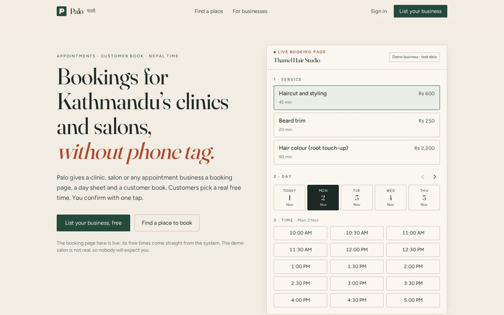
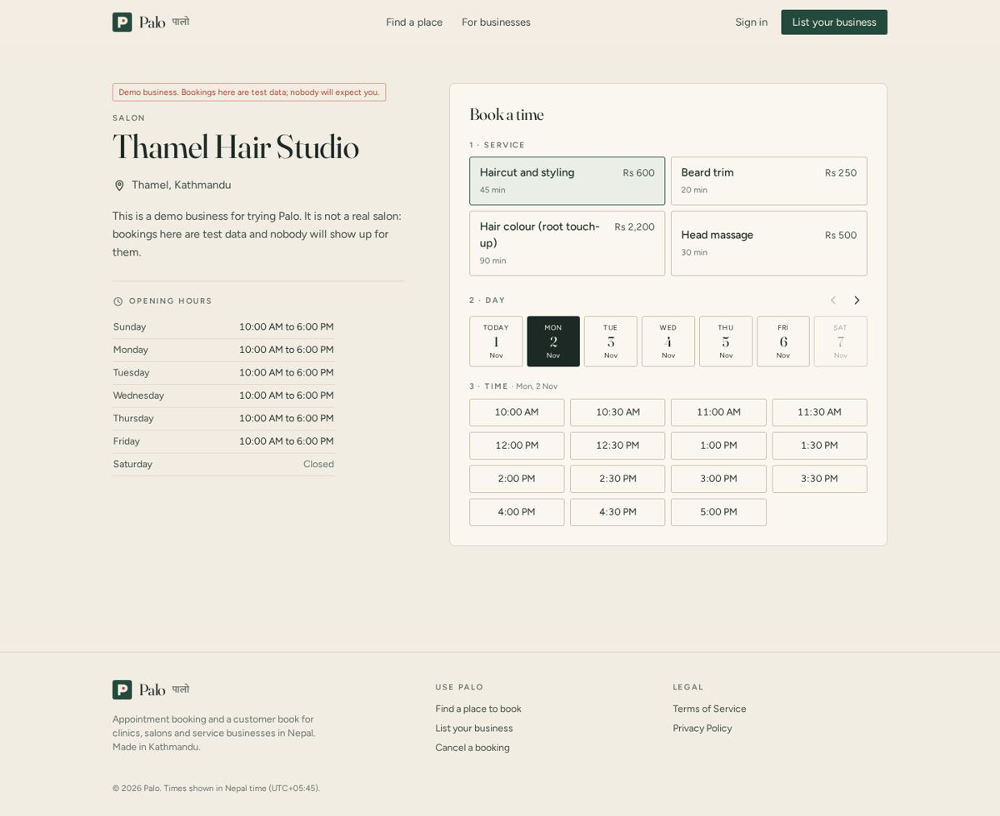
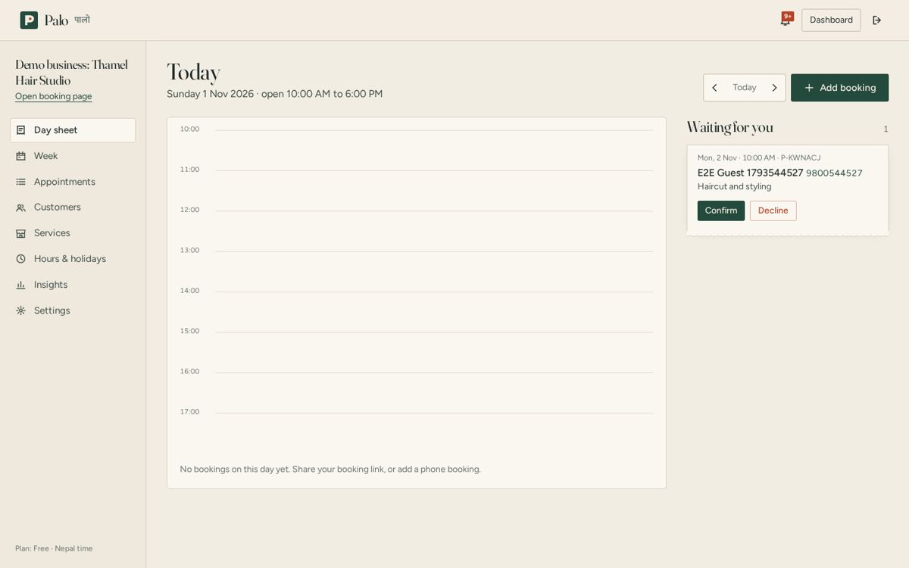
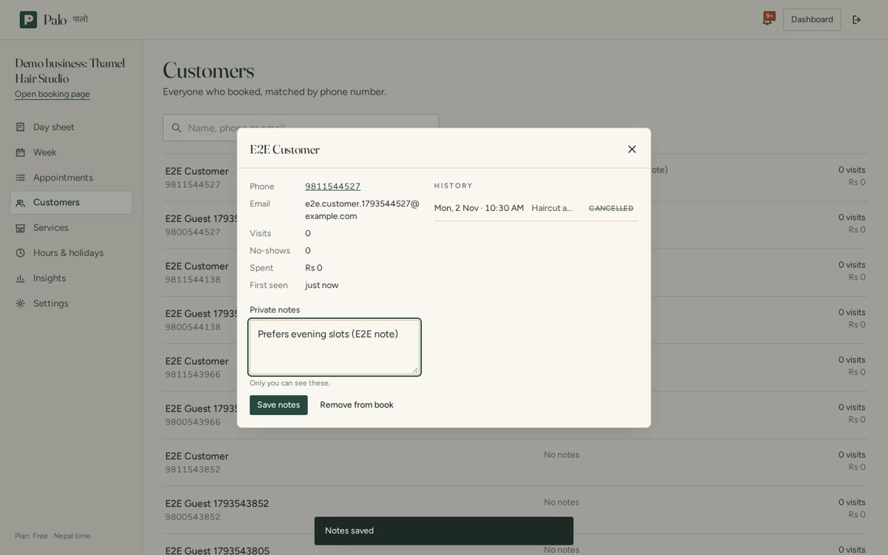
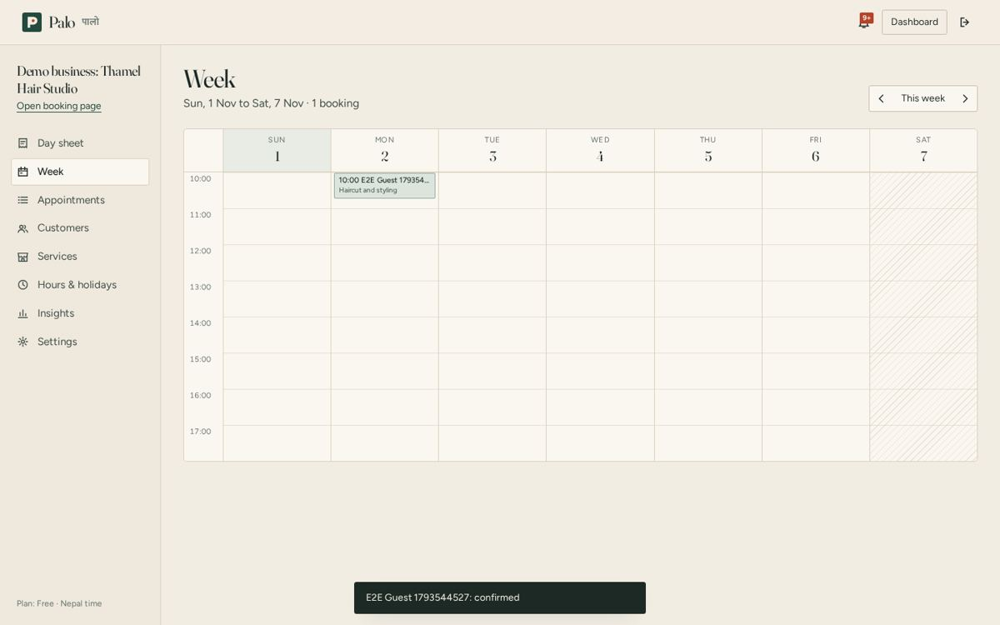
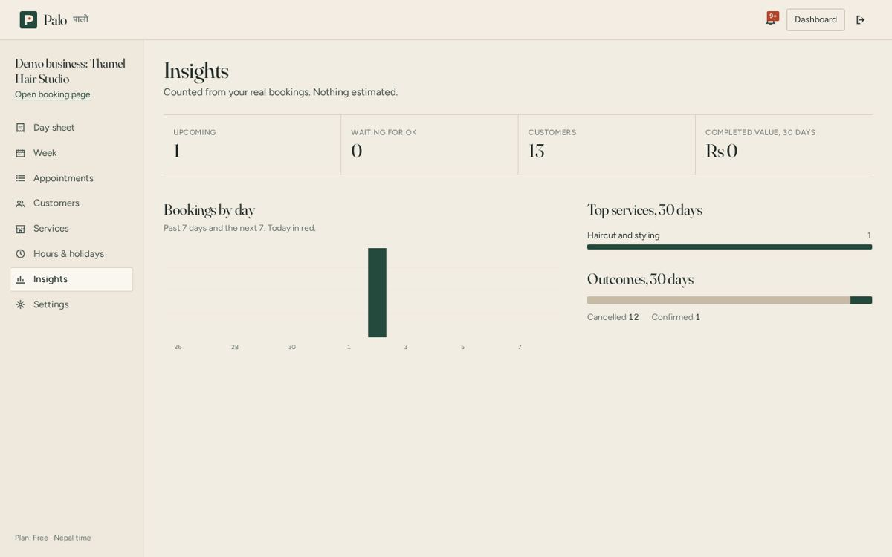

# Palo · पालो

**Appointment booking and a customer book for clinics, salons and small service businesses in Nepal.**
Day 1 of a 100-day, 100-platform build.

Live: **https://palo.sites.tab.bot/** · Demo booking page: https://palo.sites.tab.bot/b/demo-business-thamel-hair-studio

"Palo" means *turn* in Nepali, as in "it's your palo". Every booking ends with a printed-style token slip carrying a code the customer can cancel with.



## What it does

**Customers** (no account needed)
- Find a business in the directory (search by name or area, filter by category)
- Pick a service, a day and a real free time; book with a name and a Nepal mobile number
- Get a token slip with a booking code; cancel online up to 1 hour before (code + phone, or from the account)
- Optional account: all bookings in one place, profile, password change, account deletion, notifications

**Business owners**
- Booking page at `/b/your-business`, live as soon as one service exists
- Day sheet: timeline of the day with a now-line, plus a "Waiting for you" queue to confirm or decline requests
- Week calendar, appointment list with search and status filter, phone and walk-in bookings
- Status flow: waiting → confirmed → done / no-show / cancelled (invalid jumps are refused by the API)
- Customer book filled automatically by phone number: visits, no-shows, total spent, private notes, remove on request
- Services (name, duration, price in NPR, hide/show), opening hours, holidays/closed days
- Booking rules: customers served at once (capacity), slot interval, minimum notice, auto-confirm
- Insights from real data only: bookings by day (past and next 7 days), top services, outcomes
- In-app notifications for new bookings and cancellations; Pro plan request

**Platform admin**
- Overview counts and bookings-created chart (demo data included and labelled)
- Businesses: search, pause/activate a booking page, set plan and paid-until date
- People: search, filter by role, disable/enable (disabling ends their sessions)
- Audit log of admin and settings actions

| Booking page | Day sheet | Customer book |
|---|---|---|
|  |  |  |

| Week | Insights | Mobile |
|---|---|---|
|  |  |  |

## Stack

| Layer | Choice |
|---|---|
| Frontend | React 18, Vite 5, TypeScript, Tailwind CSS 3, Motion (LazyMotion), a 30-line history router, lazy-loaded routes |
| API | One Cloudflare Worker (`api/src/worker.ts`) serving `/api/*` and the built SPA through the static-assets binding |
| Database | **Cloudflare D1 (SQLite)**. It replaces PostgreSQL + Prisma so the whole product runs at **$0** on free tiers. The schema lives in `api/src/schema.ts` and is created by the Worker. |
| Auth | Own implementation: PBKDF2-SHA256 (100k iterations) password hashes, random 256-bit session tokens stored hashed, `HttpOnly; Secure; SameSite=Lax` cookie, 14-day expiry, sessions revoked on password change and on disable |
| Security | RBAC (customer / owner / admin) on every route; CSRF defence (Origin + Sec-Fetch-Site checks, JSON-only writes); D1-backed rate limits on login, signup, booking and cancellation; parameterised SQL everywhere; CSP, frame-ancestors none, nosniff headers; generic login errors with constant work |
| Booking safety | Capacity is enforced in a single `INSERT … SELECT … WHERE (overlapping bookings) < capacity`, so two customers cannot take the last seat at the same moment |
| Fonts & icons | Fraunces + Figtree + Mukta (Devanagari), self-hosted, SIL Open Font License. Palo's own SVG icon set, no icon library |

Nepal-specific: Nepal time (UTC+05:45) for all slots, Nepal mobile/landline validation (98/97/96 and 0x numbers, with or without +977), Saturday closed by default, prices in NPR, "pay at the venue · eSewa / Khalti accepted at the counter" messaging.

## Run it locally

```bash
npm install
npm test            # API unit tests (node --test, uses node:sqlite as a D1 stand-in)
npm run build       # tsc + vite build + bundles the Worker into dist/site
```

`dist/site` is a complete Cloudflare Worker folder (`_worker.js` + `tab-site.json` + static assets). To deploy it yourself with Wrangler, bind a D1 database as `DB` and the assets as `ASSETS`.

**First admin:** `POST /api/setup` with a setup key whose SHA-256 is `SETUP_KEY_SHA256` in `api/src/worker.ts`. Only the hash is in this repository. Replace it with the hash of your own random key before deploying a fork. The endpoint works once, while no admin exists.

## Business model (summary)

Freemium SaaS for appointment businesses in the Kathmandu Valley. Free plan does the core job; **Pro is Rs 999/month** for hands-on setup help and priority support, paid by eSewa, Khalti or bank transfer (arranged directly during the pilot; no card form on the site). Optional one-time setup service Rs 1,500–3,000. Acquisition: walk-in sales area by area, a counter QR poster, salon/dental Facebook groups, bundling with ADSRUN AGENCY website clients. Operating cost today: $0. Revenue today: Rs 0. Scenarios (not forecasts): 30 Pro businesses ≈ Rs 30k/month, 100 ≈ Rs 1 lakh/month.

## Honest limits

- No online payments: eSewa/Khalti merchant integration needs a registered business and merchant keys.
- No SMS or email reminders yet (they cost money per message; needs approval and a provider). Notifications are in-app.
- One calendar per business with a capacity number; no per-staff calendars yet.
- English interface; Nepali (Devanagari) UI translation not done yet.
- Free hosting limits apply (Cloudflare Workers and D1 free tiers).

## License

MIT. Fonts are under the SIL Open Font License (see `public/fonts/`).
